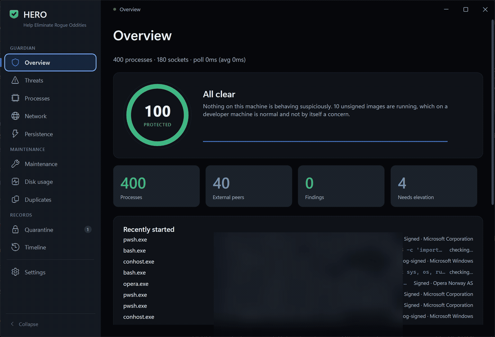

# HERO — Help Eliminate Rogue Oddities

A tray-resident adaptive host-defence and maintenance tool for Windows 11.

<p align="center">
  
</p>

<p align="center"><sub>Recorded on a real machine. Paths, remote addresses and one account name are
blurred — everything else is live.</sub></p>

**A tool that can suspend a process, remove an autorun and take a file away is asking for a lot of
trust.** HERO is built so that you have to extend as little of it as possible.

Most of what a Windows machine does, it does without telling you. HERO sits in the tray and watches
the parts you would otherwise have to go looking for — every process, the sockets each one has open,
and every place software can arrange to start itself again after a reboot. What shapes it is not
what it can catch. It is what it refuses to do.

- **It never deletes what it suspects.** Quarantine writes a restore manifest — original path,
  timestamps, attributes, the ACL in SDDL form — *before* the file is moved. If the manifest cannot
  be written, nothing is quarantined. Terminating a process tree is the one genuinely irreversible
  thing HERO can do, and it is bound by everything in the next line.
- **It never acts on one signal.** Acting on its own initiative requires a hard indicator by
  default, is capped at five actions an hour and two per sweep, and is switched off entirely for the
  first 72 hours — long enough that its first impression of a machine running Unreal, Blender and a
  dozen language toolchains is formed before it is trusted with a kill switch. A protected set of
  processes, services and paths is consulted before every action and cannot be overridden by any
  score.
- **It says what it cannot see.** Running unelevated it can enumerate every process but not read
  every image path, so the Overview carries a *Needs elevation* tile counting the ones it cannot,
  rather than reporting a blind spot as "clean".

None of this asks to be taken on faith. [`docs/PLATFORM-FACTS.md`](docs/PLATFORM-FACTS.md) is the
engineering record underneath it, kept in the order the work happened, including the days HERO was
wrong about itself: the build whose beautiful idle CPU figure turned out to mean it only monitored
while its window was open; the hardening pass that left quarantined files readable and runnable by
every account on the machine; the moment it shipped its own background service and immediately
reported it on its own Threats page.

Zero NuGet packages. One outbound network call in 38,679 lines, and that one is a reverse DNS lookup
you can switch off.

## What it is

Two halves, one app:

**Guardian.** Continuously observes processes, per-process network sockets, and every place on
Windows that software can arrange to start itself. It learns what is normal *for this machine*,
scores deviations, and neutralises high-confidence threats reversibly.

**Maintenance.** Reclaims disk space, prunes developer caches, audits startup bloat, reports drive
and system health, and sweeps for application updates.

## Design principles

**Precision over recall.** False positives are the primary risk in a tool that can kill processes.
Nine unsigned binaries are running on this machine right now and every one is benign — `uv.exe`,
Python venv shims, MCP wrappers, and Microsoft's own `WidgetService.exe`. So no single signal ever
justifies action; high confidence requires several independent, corroborating signal families.

**Reversible before destructive.** HERO suspends before it kills, and quarantines before it
deletes — in fact it never deletes. Everything it removes goes to a vault with a manifest complete
enough to restore the file byte-for-byte, including timestamps and ACLs. A false positive should
cost one click, not a file.

**Structurally incapable of breaking Windows.** A protected set of processes, services and paths is
consulted before every action and cannot be overridden by any score.

**Honest about its blind spots.** Running unelevated, HERO can read all 358 processes but only 226
image paths, and the Security event log is closed to it. It says so in the UI rather than reporting
a blind spot as "clean".

**Cheap.** Measured tray-resident cost: **1.6% of one core (0.067% of 24 threads) and 105 MB**,
while watching 350+ processes and 150 sockets every second.

## Building

Requires the .NET 10 SDK. Nothing else — there are zero NuGet packages by design.

```bash
dotnet build "D:\My projects\hero\src\Hero\Hero.csproj"
```

To run:

```bash
dotnet run --project "D:\My projects\hero\src\Hero\Hero.csproj"
```

Pass `--tray` to start hidden in the system tray, which is how it runs at logon.

HERO ships `asInvoker` and deliberately does **not** request administrator rights at launch. A tray
app that triggers a UAC prompt on every boot teaches you to click through prompts, which is a net
security loss. Operations that genuinely need elevation ask for it, individually, at the moment
they are needed.

## Where it keeps things

Everything lives under `%LOCALAPPDATA%\HERO`:

| Path | Contents |
|---|---|
| `baseline.json` | The learned behavioural model of this machine |
| `settings.json` | Your settings, autonomy level and allowlists |
| `vault/` | Quarantined files plus their restore manifests |
| `undo/` | Undo records for persistence removals and firewall rules |
| `events/` | Forensic snapshots and incident history |
| `logs/` | Diagnostics |

Uninstalling is deleting the executable and that folder. Nothing is written to the registry except
the run-at-logon entry, if you enable it.

## Privacy

HERO makes exactly one kind of network request, and you can turn it off: a **reverse DNS lookup**
to name the addresses your programs are connected to, so the Network screen can show
`spclient.wg.spotify.com` instead of `35.186.224.24`. That query goes to the DNS resolver this
machine already uses — the same resolver that performed the forward lookup moments earlier — so it
learns nothing it did not already know. Switch off "Name network peers" in Settings and HERO makes
no network requests at all.

Nothing else leaves the machine. There is no cloud reputation service, no telemetry and no account.
Signature verification runs with revocation checking disabled specifically so it cannot phone out to
CRL/OCSP endpoints and leak an inventory of your software, and file verdicts come from Windows
Defender running locally rather than from a third-party API.

## Documentation

- [`docs/PLATFORM-FACTS.md`](docs/PLATFORM-FACTS.md) — measured platform truths. Every number was
  verified on the target machine. Read this before changing the engine.
- [`docs/design/`](docs/design/) — the design specifications for each subsystem, each with an
  adversarial critique appended.
